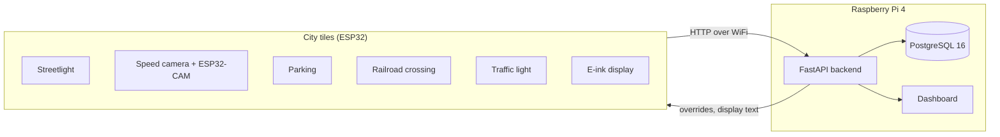

# City Sim — City of The Embedded Alliance

A miniature smart city built for **Studio Smart Cities** at the Hogeschool van Amsterdam (HBO-ICT, semester 2, 2025-2026).
Every team member built one or more physical city tiles with an ESP32 and sensors. The tiles send their data over WiFi to one shared backend, which stores it, shows it on a live dashboard and can steer the tiles back (for example an emergency mode that turns every traffic light red).

- **Documentation site:** <http://city-the-embedded-alliance-city-sim-learning-group-4a0740.dev.hihva.nl>
- **Team:** The Embedded Alliance — Betül Aydin, Gurpreet Singh, Matin Khajehfard, Thijmen Walter, Wesley Oerlemans
- **Client:** Gemeente Amsterdam, department Verkeer & Openbare Ruimte, represented by "the mayor" Mats Otten
- **Coaches:** Mats Otten and Gerald Stap
- **Period:** February – June 2026 (Sprint 0 to Sprint 4)

## Contents

- [What is in the city](#what-is-in-the-city)
- [How it works](#how-it-works)
- [Repository layout](#repository-layout)
- [What you need](#what-you-need)
- [Getting started](#getting-started)
  - [1. Clone the repository](#1-clone-the-repository)
  - [2. Run the backend](#2-run-the-backend)
  - [3. Build and upload the firmware](#3-build-and-upload-the-firmware)
  - [4. Run the documentation site](#4-run-the-documentation-site)
- [Deployment on the Raspberry Pi](#deployment-on-the-raspberry-pi)
- [Tests](#tests)
- [API overview](#api-overview)
- [Who did what](#who-did-what)
- [Timeline](#timeline)

## What is in the city

| Tile | What it does | Hardware | Built by |
|------|--------------|----------|----------|
| Smart streetlight | Switches the light on when it gets dark | ESP32-S3, LDR, relay | Gurpreet |
| Speed camera | Measures the speed between two IR sensors (converted to real speed at scale 1:64) and takes a photo of cars that are too fast | ESP32-S3, 2 IR sensors, OLED, ESP32-CAM | Gurpreet |
| Smart parking | Detects which parking spots are taken and shows the free spots | ESP32-S3, 4× HC-SR04 via an MCP23017, OLED | Matin (first tile), Gurpreet (city-sim version) |
| Railroad crossing | Predicts when a reported train arrives, warns with lights and a buzzer and closes the barrier | ESP32-S3, push button as train sensor, LEDs, buzzer, servo | Thijmen |
| E-ink city display | Shows the city name, logo and messages sent from the backend | ESP32-C3 / ESP32-S3, e-ink display | Thijmen |
| Four-way traffic light | Runs a crossroads and reports waiting cars to the backend | ESP32-S3, MCP23017, ULN2803, KY-021 sensor | Wesley |
| Pedestrian crossing | Two opposite crossings with push buttons and red/green lights | ESP32-S3, buttons, LEDs | Betül |

The shared firmware in `embedded/city-sim` runs the streetlight, speed camera, parking, railroad crossing and e-ink display together on one ESP32-S3 ("City Hub").

## How it works



- The tiles talk **HTTP** (no MQTT) to the backend under `/api/v1/...`.
- The backend is a **FastAPI** app with a **PostgreSQL** database. It runs in Docker on the team's Raspberry Pi, and there is also a K3s (Kubernetes) setup with autoscaling.
- The dashboard at `/` refreshes every 2 seconds. The interactive API docs (Swagger) are at `/docs`.
- The full architecture is described in [`docs/Matin/system-architecture.md`](docs/Matin/system-architecture.md) and the database in [`docs/Matin/database-schema.md`](docs/Matin/database-schema.md).

## Repository layout

```
.
├── backend/              FastAPI backend, Docker Compose, K3s manifests, scripts, tests
│   ├── app/              the API (main.py, models.py, routers/, static/ dashboard)
│   ├── k8s/              K3s manifests with autoscaling (see backend/k8s/README.md)
│   ├── scripts/          database backup, restore and backup check
│   └── tests/            override, resilience and autoscaling tests
├── embedded/             ESP32 firmware
│   ├── city-sim/         shared City Hub firmware (all tiles in one sketch, lib/ per tile)
│   ├── city-sim-cam/     ESP32-CAM firmware for the speed camera photos
│   ├── city-sim-e-ink-only/  e-ink display on its own (ESP32-C3)
│   └── <name>/           each team member's own prototypes and experiments
├── docs/                 MkDocs documentation: project pages and one folder per team member
├── mdocotion/            HBO-ICT MkDocs theme (git submodule)
├── mkdocs.yml            documentation site configuration
├── requirements.txt      Python packages for the documentation site
└── .gitlab-ci.yml        builds the documentation site on GitLab Pages
```

## What you need

**Software**

| For | Tool |
|-----|------|
| Backend | [Docker](https://docs.docker.com/get-docker/) with Docker Compose |
| Firmware | [Arduino CLI](https://arduino.github.io/arduino-cli/) (or the Arduino IDE 2) with the `esp32:esp32` core |
| Documentation site | Python **3.11**, the version GitLab CI uses for the pinned (older) MkDocs packages |
| K3s deployment (optional) | A Raspberry Pi 4 with K3s |

**Hardware** (only to run the physical city)

- ESP32-S3 boards for the tiles, an ESP32-CAM for the speed camera photos and an ESP32-C3 for the stand-alone e-ink display
- The sensors and actuators listed in [What is in the city](#what-is-in-the-city)
- A Raspberry Pi 4 for the backend, and a WiFi network that the boards and the Pi share

## Getting started

### 1. Clone the repository

The documentation theme is a git submodule, so clone with `--recurse-submodules`:

```bash
git clone --recurse-submodules git@gitlab.fdmci.hva.nl:studio/smart-cities/projecten/2025-2026-semester-2/city-sim-learning-group/city-the-embedded-alliance-city-sim-learning-group.git city-sim
cd city-sim
```

Already cloned without it? Run `git submodule update --init`.

### 2. Run the backend

```bash
cd backend
cp .env.example .env        # Windows (cmd): copy .env.example .env
```

`.env` holds the database connection for the API (`DATABASE_URL`) and the user, password and database the PostgreSQL container creates (`POSTGRES_*`). The defaults (`citysim`) are fine on your own machine. On the Pi, choose a real password and put it in both `POSTGRES_PASSWORD` and `DATABASE_URL`.

Start the API and the database:

```bash
docker compose up --build
```

The API listens on **port 80** of your machine:

| What | URL |
|------|-----|
| Dashboard | <http://localhost/> |
| Health check | <http://localhost/health> |
| Swagger API docs | <http://localhost/docs> |

Port 80 already in use? Change `"80:8000"` under `api` → `ports` in `docker-compose.yml`, for example to `"8000:8000"`, and use `http://localhost:8000`.

Try it with a few requests:

```bash
# mark parking spot 1 as taken, then read the parking status
curl -X POST "http://localhost/api/v1/parking/update/1?is_occupied=true"
curl http://localhost/api/v1/parking/status

# send a generic reading from any tile
curl -X POST http://localhost/api/v1/readings \
  -H "Content-Type: application/json" \
  -d '{"tile": "streetlight", "sensor_type": "ldr", "value": 650, "unit": "lux"}'

# emergency mode: every tile switches at once (traffic all red, barrier closed, ...)
curl -X POST http://localhost/api/v1/override/emergency
```

Stop it with `Ctrl+C`, or `docker compose down` (add `-v` to also delete the database).

### 3. Build and upload the firmware

The sketches use **Arduino CLI sketch profiles** (`sketch.yaml`). A profile pins the board, the ESP32 core version and every library, so Arduino CLI installs the right versions itself.

1. **Fill in your network settings.** These files are committed with empty values; never commit your own WiFi password.
   `API_BASE_URL` is the address of the machine that runs the backend as the board sees it, for example `http://145.92.8.137` for the team's Pi or `http://<your-laptop-ip>` for a backend on your laptop. `localhost` does not work: on the board that is the board itself. The board and the backend must be on the same network.

   | Sketch | File | Settings |
   |--------|------|----------|
   | `embedded/city-sim` | `lib/Config/Config.h` | `WIFI_SSID`, `WIFI_PASSWORD`, `API_BASE_URL` (address of the backend) |
   | `embedded/city-sim-e-ink-only` | `lib/Config/Config.h` | `WIFI_SSID`, `WIFI_PASSWORD`, `API_BASE_URL` |
   | `embedded/city-sim-cam` | `lib/esp32cam/esp32cam.h` | `WIFI_SSID`, `WIFI_PASSWORD`, `BACKEND_CAMERA_REGISTER_URL`, `CAMERA_ID` |
   | Wesley's network sketches | a new `secrets.h` next to the `.ino` (gitignored) | `#define WIFI_SSID "..."` and `#define WIFI_PASSWORD "..."` |

   All pin numbers are in the same `Config.h`, one namespace per tile.

2. **Compile and upload** (replace the port with your board's port, e.g. `COM9` on Windows or `/dev/ttyACM0` on Linux):

   ```bash
   arduino-cli compile --profile city-sim embedded/city-sim
   arduino-cli upload  --profile city-sim -p COM9 embedded/city-sim
   arduino-cli monitor -p COM9 -c baudrate=115200
   ```

   The other sketches with a `sketch.yaml` work the same way with their own profile name (shown at the top of that file):

   | Sketch | Board |
   |--------|-------|
   | `embedded/city-sim` | ESP32-S3 (City Hub) |
   | `embedded/city-sim-cam` | ESP32-CAM |
   | `embedded/city-sim-e-ink-only` | ESP32-C3 |
   | `embedded/Parking`, `embedded/hello-world`, `embedded/Gurpreet/streetlight`, `embedded/Gurpreet/speed_camera/*` | ESP32-S3 / ESP32-CAM |

   The sketches in the personal folders without a `sketch.yaml` are prototypes; open them in the Arduino IDE and pick an ESP32-S3 board.

   Good to know:

   - **The first compile takes a while.** Arduino CLI downloads the ESP32 core and its toolchains on its own: several GB per core version, and the profiles use two versions (3.2.0 and 3.3.7), so expect about 14 GB in total.
   - **The upload does not start?** Hold the **BOOT** button of the ESP32-S3 while the upload begins, and check that the board shows up as a port (`arduino-cli board list`).
   - **ESP32-CAM:** this board has no USB port of its own. Flash it on an ESP32-CAM-MB programmer board or through a USB-serial adapter.
   - **Serial monitor:** use 115200 baud. The exception is `esp32-mac-address`, which uses 9600.

### 4. Run the documentation site

The site is built with MkDocs, the Material theme and the HBO-ICT `mdocotion` theme, the same way GitLab CI does it:

```bash
python3.11 -m venv .venv           # Windows: py -3.11 -m venv .venv
source .venv/bin/activate          # Windows: .venv\Scripts\activate
pip install -r requirements.txt
cd mdocotion && python setup.py install && cd ..
mkdocs serve
```

Open <http://127.0.0.1:8000>. Every push to `main` publishes the site to GitLab Pages (the `pages` job in `.gitlab-ci.yml`).

`python setup.py install` leaves build files in the `mdocotion` folder, so `git status` shows the submodule as modified. That is only build output; do not commit it.

All documentation lives in `docs/` as Markdown: the project pages ([`index.md`](docs/index.md), [`tile objectives.md`](docs/tile%20objectives.md), [`raspberry-pi-deployment.md`](docs/raspberry-pi-deployment.md)) and one folder per team member with their sprint deliverables and learning goals.

## Deployment on the Raspberry Pi

The backend runs on the team's Raspberry Pi 4 on the HvA network.

- **Docker Compose:** [`docs/raspberry-pi-deployment.md`](docs/raspberry-pi-deployment.md) explains the Pi setup. `cd backend && ./deploy.sh` creates `.env` from `.env.example` when it is missing, starts the stack in the background and waits for `/health`. Set a real password in `.env` before the first start (see [step 2](#2-run-the-backend)).
- **Cluster with failover:** `backend/docker-compose.cluster.yml` puts NGINX in front of two or more API replicas:
  `docker compose -f docker-compose.cluster.yml up --build --scale api=2`
- **K3s with autoscaling:** [`backend/k8s/README.md`](backend/k8s/README.md) covers the K3s install, the secret, the manifests (2 to 5 API replicas at 50% CPU, one PostgreSQL pod), testing on port 30080 and rollback.
- **Backups:** `backend/scripts/backup.sh` makes a `pg_dump` (7 days kept), `check_backup.sh` warns when the newest backup is too old or too small, and `restore.sh` restores a dump into a test database.

## Tests

The tests are plain Python and shell scripts that run against a running backend.

```bash
cd backend

# emergency override: trigger, check all 5 tiles, clear, check the city is back to normal
python3 tests/override/override_test.py --url http://localhost

# load, soak and recovery tests against the cluster stack (see tests/resilience/README.md)
docker compose -f docker-compose.cluster.yml up --build -d --scale api=2
python3 tests/resilience/resilience_test.py load --url http://localhost/health --seconds 30 --concurrency 20
docker ps --filter "name=api" --format "{{.ID}} {{.Names}}"
python3 tests/resilience/resilience_test.py recovery --url http://localhost/health --container <api-container-id>

# K3s autoscaling: 5 pods load the API for 3 minutes (see tests/autoscaling/README.md)
kubectl apply -f tests/autoscaling/load.yaml
kubectl get hpa -n citysim -w

# everything in one go on the Pi, results in tests/pi_results_<date>.txt
./tests/run_pi_tests.sh
```

The load test sends far more than the 10 requests per second per IP that NGINX allows for the tiles (`limit_req` in `nginx.conf`). Its error percentage therefore counts the `503` answers of that rate limit, and from one machine most requests end up there; the team's own run on the Pi recorded 93.75%. To measure the API itself, raise the limit in `nginx.conf` while testing.

The recovery test kills one API replica and should report it healthy again within 5 seconds.

## API overview

All endpoints start with `/api/v1`. Swagger at `/docs` lists every parameter.

| Area | Endpoints |
|------|-----------|
| Readings (any tile) | `POST /readings`, `GET /readings`, `GET /readings/latest/{tile}` |
| Parking | `GET /parking/status`, `POST /parking/update/{spot}?is_occupied=`, `GET /parking/spots`, `GET /parking/spots/{spot}` |
| Railroad crossing | `/railroadcrossing/train` (first sensor, second sensor, crossed) and `/railroadcrossing/barrier` (log, `is-closed`) |
| Speed camera | `POST /speedcamera/`, `GET /speedcamera/violations`, `GET /speedcamera/stats`, `POST /speedcamera/camera/register` |
| Traffic light | `POST /traffic`, `GET /traffic`, `GET /traffic/latest` |
| E-ink display | `GET /eink-display/payload`, `PUT /eink-display` |
| Overrides | `POST /override`, `GET /override/active?target=`, `POST /override/{id}/clear`, `POST /override/emergency` |

## Who did what

| Team member | Role | Contribution |
|-------------|------|--------------|
| **Betül Aydin** | Scrum Master, developer | Pedestrian crossing tile (`embedded/betül/pedestrian_crossing`). Backend endpoint for the traffic light data (`backend/app/routers/traffic.py`). Security and reliability: HTTPS through an NGINX reverse proxy, container separation and health checks (`backend/nginx.conf`, `docker-compose.https-test.yml`). |
| **Gurpreet Singh** | Developer | Smart streetlight and the shared City Hub firmware (`embedded/city-sim`). Speed camera with ESP32-CAM photos (`embedded/Gurpreet/speed_camera`, `lib/SpeedCamera`). Smart parking in the City Hub with four sensors on an MCP23017 that only sends changes (`lib/Parking`). |
| **Matin Khajehfard** | Developer / Backend | First parking tile (`embedded/matin/parking`). The shared FastAPI backend, database and Docker setup. Raspberry Pi deployment, dashboard and speed camera API. Cluster with failover, backups, K3s autoscaling and the emergency override "surprise" (`backend/app/routers/override.py`). |
| **Thijmen Walter** | Developer | Railroad crossing with train prediction signal and barrier (`embedded/Thijmen/train-prediction-signal`, `lib/TrainPredictionSignal`, train and barrier tables). E-ink city display with text from the backend (`lib/EinkDisplay`, `embedded/city-sim-e-ink-only`, `routers/eink_display.py`). Perfboard and KiCad PCB for the e-ink module. |
| **Wesley Oerlemans** | Developer | Traffic light and four-way crossroads with an MCP23017 and ULN2803 (`embedded/Wesley`). KY-021 sensor that reports waiting cars to the backend. ESP32-S3 pinout research, and moving the circuit from breadboard to perfboard. |

Each member's sprint deliverables, research and learning goals are in their own folder under [`docs/`](docs/).

## Timeline

| Phase | What | Weeks |
|-------|------|-------|
| Sprint 0 | Planning and requirements | 1–3 |
| Sprint 1 | Analysis, design, first prototype per tile, show & tell | 3–6 |
| Sprint 2 | Integration into the shared firmware, Raspberry Pi deployment | 6–9 |
| Sprint 3 | Iteration: more tiles talking to the backend, dashboard, e-ink display | 9–12 |
| Sprint 4 | Professionalising: perfboards and PCB, HTTPS, failover, backups, K3s autoscaling, emergency override | 12–15 |
