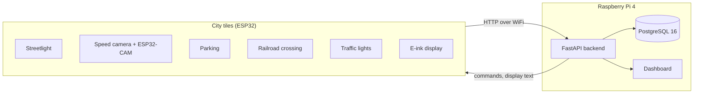

# City Sim: City of The Embedded Alliance

A small smart city we built for Studio Smart Cities at the Hogeschool van Amsterdam (HBO-ICT, semester 2, 2025-2026).
Each of us built one or more city tiles with an ESP32 and sensors. The tiles send their data over WiFi to one backend. The backend stores it, shows it on a live dashboard and can also send commands back, for example an emergency mode that turns every traffic light red.

- **Team:** Betül Aydin, Gurpreet Singh, Matin Khajehfard, Thijmen Walter and Wesley Oerlemans
- **Client:** Gemeente Amsterdam (Verkeer & Openbare Ruimte), played by "the mayor" Mats Otten
- **Coaches:** Mats Otten and Gerald Stap
- **Period:** February to June 2026
- **Documentation site:** <http://city-the-embedded-alliance-city-sim-learning-group-4a0740.dev.hihva.nl>

## The tiles

| Tile | What it does | Hardware | Built by |
|------|--------------|----------|----------|
| Streetlight | Turns the light on when it gets dark | ESP32-S3, LDR, relay | Gurpreet |
| Speed camera | Measures the speed between two IR sensors, converts it to real speed (scale 1:64) and takes a photo of cars that drive too fast | ESP32-S3, 2 IR sensors, OLED, ESP32-CAM | Gurpreet |
| Parking | Sees which spots are taken and shows how many are free | ESP32-S3, 4 HC-SR04 sensors on an MCP23017, OLED | Matin (first version), Gurpreet (City Hub version) |
| Railroad crossing | Predicts when a train arrives, warns with lights and a buzzer and closes the barrier | ESP32-S3, push button as train sensor, LEDs, buzzer, servo | Thijmen |
| E-ink display | Shows the city name, the logo and messages from the backend | ESP32-C3 or ESP32-S3, e-ink screen | Thijmen |
| Traffic lights | Runs a four-way crossing and reports waiting cars to the backend | ESP32-S3, MCP23017, ULN2803, KY-021 sensor | Wesley |
| Pedestrian crossing | Two crossings facing each other, with push buttons and red/green lights | ESP32-S3, buttons, LEDs | Betül |

The streetlight, speed camera, parking, railroad crossing and e-ink display also run together on one ESP32-S3, the "City Hub" (`embedded/city-sim`).

## How it works



The tiles send plain HTTP requests to `/api/v1/...`. The backend is a FastAPI app with a PostgreSQL database, running in Docker on our Raspberry Pi. There is also a K3s (Kubernetes) setup that adds API copies when it gets busy. The dashboard at `/` refreshes every 2 seconds, and `/docs` shows every endpoint.

More detail: [`docs/Matin/system-architecture.md`](docs/Matin/system-architecture.md) and [`docs/Matin/database-schema.md`](docs/Matin/database-schema.md).

## What is where

```
backend/                 the API, Docker files, K3s files, scripts and tests
  app/                   the API itself, with the dashboard in static/
  k8s/                   K3s setup (own README)
  scripts/               database backup, restore and backup check
  tests/                 emergency mode, load, recovery and autoscaling tests
embedded/                firmware for the boards
  city-sim/              the City Hub: five tiles in one sketch, one lib/ folder per tile
  city-sim-cam/          ESP32-CAM that takes the speed camera photos
  city-sim-e-ink-only/   the e-ink display on its own board (ESP32-C3)
  <name>/                each team member's own prototypes
docs/                    the documentation site, with a folder per team member
mdocotion/               HBO-ICT theme for the site (git submodule)
```

## What you need

- [Docker](https://docs.docker.com/get-docker/) to run the backend
- [Arduino CLI](https://arduino.github.io/arduino-cli/) or the Arduino IDE 2 for the firmware
- Python 3.11 for the documentation site (its packages are pinned to older versions that go with 3.11)
- For the real city: the boards and parts from the table above, a Raspberry Pi 4 for the backend, and one WiFi network for all of them

## Getting started

### 1. Clone

The site theme is a git submodule, so add `--recurse-submodules`:

```bash
git clone --recurse-submodules https://github.com/guruITA/smart-city-sim.git
cd smart-city-sim
```

Forgot it? Run `git submodule update --init`.

### 2. Start the backend

```bash
cd backend
cp .env.example .env        # Windows cmd: copy .env.example .env
docker compose up --build
```

`.env` holds the database login. The default `citysim` is fine on your own computer. On the Pi, pick a real password and put it in both `POSTGRES_PASSWORD` and `DATABASE_URL`.

The backend runs on port 80:

- dashboard: <http://localhost/>
- health check: <http://localhost/health>
- all endpoints: <http://localhost/docs>

Is port 80 taken? Change `"80:8000"` in `docker-compose.yml` to `"8000:8000"` and use `http://localhost:8000`.

A few requests to try:

```bash
# mark parking spot 1 as taken, then ask how many spots are free
curl -X POST "http://localhost/api/v1/parking/update/1?is_occupied=true"
curl http://localhost/api/v1/parking/status

# send a reading, as a tile would
curl -X POST http://localhost/api/v1/readings \
  -H "Content-Type: application/json" \
  -d '{"tile": "streetlight", "sensor_type": "ldr", "value": 650, "unit": "lux"}'

# emergency mode: traffic lights red, barrier down, and so on
curl -X POST http://localhost/api/v1/override/emergency
```

Run them in a terminal on Linux or macOS. You can also paste them into [Bruno](https://www.usebruno.com/) or [Postman](https://www.postman.com/), one command at a time: both turn a curl command into a request you can send with one click. On Windows that is the easiest way, because PowerShell has its own `curl` that does not understand these options.

Stop with `Ctrl+C` or `docker compose down`. Add `-v` to also throw away the database.

### 3. Put the firmware on a board

**Network settings first.** These files are in git with empty values. Fill them in, but never commit your own WiFi password.

| Sketch | File | What to fill in |
|--------|------|-----------------|
| `embedded/city-sim` and `embedded/city-sim-e-ink-only` | `lib/Config/Config.h` | `WIFI_SSID`, `WIFI_PASSWORD`, `API_BASE_URL` |
| `embedded/city-sim-cam` | `lib/esp32cam/esp32cam.h` | `WIFI_SSID`, `WIFI_PASSWORD`, `BACKEND_CAMERA_REGISTER_URL`, `CAMERA_ID` |
| Wesley's sketches that use WiFi | make a `secrets.h` next to the `.ino` (git ignores it) | `#define WIFI_SSID "..."` and `#define WIFI_PASSWORD "..."` |
| `matin/parking` | the `.ino` itself | `WIFI_SSID`, `WIFI_PASS`, `API_BASE_URL` |

`API_BASE_URL` is the address where the board can reach the backend: `http://145.92.8.137` for our Pi, or your laptop's IP address. `localhost` won't work, because on the board that means the board itself. The board and the backend have to be on the same network. The pin numbers are in `Config.h` too.

**Build and upload.** Most sketches come with a `sketch.yaml`. That file fixes the board, the ESP32 core version and the libraries, so Arduino CLI downloads the right versions by itself. Use the name on the second line of that file as the profile:

```bash
arduino-cli compile --profile city-sim embedded/city-sim
arduino-cli upload  --profile city-sim -p COM9 embedded/city-sim     # Linux: -p /dev/ttyACM0
arduino-cli monitor -p COM9 -c baudrate=115200
```

| Sketch | Board |
|--------|-------|
| `city-sim`, `Parking`, `hello-world`, `Gurpreet/streetlight`, `Gurpreet/speed_camera/speed_camera_s3` | ESP32-S3 |
| `city-sim-cam`, `Gurpreet/speed_camera/speed_camera_cam` | ESP32-CAM |
| `city-sim-e-ink-only` | ESP32-C3 |

The prototypes in the personal folders have no `sketch.yaml`. Build them for a plain ESP32-S3 (in the Arduino IDE: **ESP32S3 Dev Module**):

```bash
arduino-cli core install esp32:esp32@3.3.7
arduino-cli lib install FastLED@3.10.3 ESP32Servo@3.1.3
arduino-cli compile --fqbn esp32:esp32:esp32s3 embedded/Wesley/traffic_light
arduino-cli upload  --fqbn esp32:esp32:esp32s3 -p COM9 embedded/Wesley/traffic_light
```

| Prototype | What it is | Libraries |
|-----------|-----------|-----------|
| `Thijmen/blink-alternating` | two LEDs blinking in turn | |
| `Thijmen/blink-rgb-led` | the built-in RGB LED and the BOOT button | FastLED |
| `Thijmen/train-prediction-signal` | railroad crossing with lights, buzzer and barrier | ESP32Servo |
| `Wesley/blink`, `blink_switch`, `flash_button` | tests with the built-in RGB LED and the BOOT button | FastLED |
| `Wesley/traffic_light` | one traffic light | |
| `Wesley/crossroad_traffic_light` | four-way crossing on an MCP23017 and ULN2803 | |
| `Wesley/crossroad_traffic_light_with_sensor` and `_v2` | the same crossing with a KY-021 car sensor that reports to the backend (needs `secrets.h`) | |
| `Wesley/ky021_sensor_test` | tests the KY-021 sensor | |
| `Wesley/testing traffic lights with MCP23017 and ULN2803/` | I²C scanner and driver tests | |
| `Wesley/wifi_backend_httpbin_test` | tests WiFi and a POST to httpbin.org (needs `secrets.h`) | |
| `betül/pedestrian_crossing` | pedestrian crossing with buttons | |
| `matin/parking` | the first parking tile, with one sensor | |
| `esp32-mac-address` | prints the board's MAC address, at 9600 baud instead of 115200 | |

Things that can trip you up:

- The first build is slow. Arduino CLI downloads the ESP32 core with all its tools, and the profiles use two versions (3.2.0 and 3.3.7). Count on about 14 GB.
- If the upload won't start, hold the **BOOT** button on the ESP32-S3 while it begins. `arduino-cli board list` shows whether the board is connected.
- The ESP32-CAM has no USB port. Flash it on an ESP32-CAM-MB board or with a USB-to-serial adapter.

### 4. Run the documentation site

On Linux or macOS:

```bash
python3.11 -m venv .venv
source .venv/bin/activate
pip install -r requirements.txt
cd mdocotion && python setup.py install && cd ..
mkdocs serve
```

On Windows, in PowerShell:

```powershell
py -3.11 -m venv .venv
Set-ExecutionPolicy -Scope Process -ExecutionPolicy Bypass
.venv\Scripts\Activate.ps1
pip install -r requirements.txt
cd mdocotion
python setup.py install
cd ..
mkdocs serve
```

PowerShell blocks the activate script by default. The `Set-ExecutionPolicy` line allows it only in that window, so the rest of your computer stays as it was.

Then open <http://127.0.0.1:8000>. The pages are Markdown files in `docs/`.

The site at the top of this README was built by the team's GitLab (`.gitlab-ci.yml`). This GitHub copy does not publish it.

## Running it on the Raspberry Pi

- **Docker:** [`docs/raspberry-pi-deployment.md`](docs/raspberry-pi-deployment.md) explains how the Pi is set up. On the Pi, `cd backend && ./deploy.sh` starts everything in the background and waits until the API answers. Set a real password in `.env` first.
- **Two API copies behind NGINX**, so one can crash without the city going down:
  `docker compose -f docker-compose.cluster.yml up --build --scale api=2`
- **K3s:** [`backend/k8s/README.md`](backend/k8s/README.md) explains the full setup. It runs 2 to 5 copies of the API depending on how busy it is, and one database. It answers on port 30080.
- **K3s on your laptop:** [k3d](https://k3d.io) runs K3s inside Docker, so you can try the K3s setup without a Pi. Start a cluster like the one on the Pi, then follow steps 2 to 5 of the K3s README. Only the image import is different:

  ```bash
  k3d cluster create citysim --k3s-arg "--disable=traefik@server:0" -p "30080:30080@server:0" --wait
  docker build -t citysim-api:0.1 backend/
  k3d image import citysim-api:0.1 -c citysim
  k3d cluster delete citysim       # when you are done
  ```
- **Backups:** `scripts/backup.sh` saves the database and keeps 7 days of backups. `check_backup.sh` warns when the last backup is too old or too small, and `restore.sh` puts a backup back into a test database.

## Tests

Run these from `backend/` while the backend is up.

On Windows, type `py` instead of `python3` (`python3` only opens the Microsoft Store there), and use `http://127.0.0.1` instead of `http://localhost`. Python on Windows first tries `localhost` over IPv6, which makes every request wait 5 seconds.

```bash
# emergency mode: switch it on, check all 5 tiles, switch it off again
python3 tests/override/override_test.py --url http://localhost

# load and recovery: start the NGINX setup first
docker compose -f docker-compose.cluster.yml up --build -d --scale api=2
python3 tests/resilience/resilience_test.py load --url http://localhost/health --seconds 30 --concurrency 20
docker ps --filter "name=api" --format "{{.ID}} {{.Names}}"
python3 tests/resilience/resilience_test.py recovery --url http://localhost/health --container <id from docker ps>

# K3s autoscaling: 3 minutes of load, the API should grow from 2 to 5 copies
kubectl apply -f tests/autoscaling/load.yaml
kubectl get hpa -n citysim -w

# all tests at once on the Pi, results go to tests/pi_results_<date>.txt
./tests/run_pi_tests.sh
```

Don't be surprised by the high error rate of the load test. NGINX lets each IP address make 10 requests per second, so the tiles can't flood the backend. The test sends far more than that from one computer, so most requests get a `503` and count as errors. On our Pi it was 93.75%. Raise the limit in `nginx.conf` if you want to measure the API itself.

The recovery test stops one API copy and passes when the backend answers again within 5 seconds.

## API endpoints

Everything starts with `/api/v1`. `/docs` shows every parameter.

| Part | Endpoints |
|------|-----------|
| Readings from any tile | `POST /readings`, `GET /readings`, `GET /readings/latest/{tile}` |
| Parking | `GET /parking/status`, `POST /parking/update/{spot}?is_occupied=`, `GET /parking/spots`, `GET /parking/spots/{spot}` |
| Railroad crossing | `/railroadcrossing/train` and `/railroadcrossing/barrier` |
| Speed camera | `POST /speedcamera/`, `GET /speedcamera/violations`, `GET /speedcamera/stats`, `POST /speedcamera/camera/register` |
| Traffic lights | `POST /traffic`, `GET /traffic`, `GET /traffic/latest` |
| E-ink display | `GET /eink-display/payload`, `PUT /eink-display` |
| Emergency and manual commands | `POST /override`, `GET /override/active?target=`, `POST /override/{id}/clear`, `POST /override/emergency` |

## Who did what

Next to their tiles (see [The tiles](#the-tiles)), everyone took on part of the rest:

- **Betül Aydin** (Scrum Master) built the backend part for the traffic lights and made the backend safer and more reliable: HTTPS through NGINX, separate containers and health checks.
- **Gurpreet Singh** set up the City Hub firmware that runs five tiles on one board, and moved the parking sensors to an MCP23017 so they need fewer pins and only send changes.
- **Matin Khajehfard** built the backend, the database, the Docker setup and the dashboard, and put it all on the Raspberry Pi. In the last sprint he made the backend keep running when one part fails, and added the backups, K3s autoscaling and the emergency mode.
- **Thijmen Walter** built the train and barrier parts of the backend and the e-ink endpoint, and designed a perfboard and a KiCad PCB for the e-ink module.
- **Wesley Oerlemans** researched the ESP32-S3 pins and moved his traffic light circuit from a breadboard to a perfboard.

Everyone's sprint work, research and learning goals are in their own folder in [`docs/`](docs/).

## Sprints

| Sprint | Weeks | What we did |
|--------|-------|-------------|
| 0 | 1 to 3 | Planning and requirements |
| 1 | 3 to 6 | Research, design and a first prototype of each tile |
| 2 | 6 to 9 | Combined the tiles in one firmware and put the backend on the Pi |
| 3 | 9 to 12 | Connected more tiles to the backend, added the dashboard and the e-ink display |
| 4 | 12 to 15 | Perfboards and a PCB, HTTPS, failover, backups, K3s autoscaling and the emergency mode |
